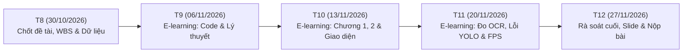

# 📅 Cấu trúc Công việc (WBS) & Đánh giá Tiến độ Theo Tuần

-blue)

> [!NOTE]
> Tài liệu này theo dõi cấu trúc phân rã công việc (**WBS**), phân công nộp bài cho **5 thành viên (TV1–TV5)** và kiểm tra tiến độ từng tuần cho tiểu luận **Xây dựng ứng dụng nhận diện biển số xe trong Hệ thống Giao thông Thông minh (ITS)** theo lịch học E-learning từ Tuần 8 đến Tuần 12.

---

## 1. Sơ đồ Lộ trình Tổng quan Theo Tuần

---

## 2. Danh sách 5 Thành viên & Phân công Sản phẩm Nộp trên GitHub

| Mã TV | Họ và tên / MSSV *(nhóm điền)* | Tài khoản GitHub *(nhóm điền)* | Nhiệm vụ trong Tiểu luận | Tệp tin phụ trách nộp trên GitHub |
| :---: | :--- | :--- | :--- | :--- |
| **TV1** | **Lê Khánh Hưng** · `[MSSV]` | `@[username-tv1]` | Phần I (Giới thiệu); Quy trình xử lý & Demo code/app (Mục 3.3–3.5, Chương 4); Hạn chế & Hướng phát triển (Mục 5.5, Phần III) | [`README.md`](README.md), [`.gitignore`](.gitignore), [`requirements.txt`](requirements.txt), [`TIEN_DO_WBS.md`](TIEN_DO_WBS.md), [`app.py`](plate_app/app.py), [`config.py`](plate_app/config.py), [`pipeline.py`](plate_app/pipeline.py), [`video_tracker.py`](plate_app/video_tracker.py), [`database.py`](plate_app/database.py), [`ui_image.py`](plate_app/ui_image.py), [`ui_video.py`](plate_app/ui_video.py), [`ui_history.py`](plate_app/ui_history.py), [`best_n640.pt`](plate_app/models/best_n640.pt) |
| **TV2** | **Trần Văn Học** · `052206005618` | `@hoctv5618-ai` | Chương 1 (Tổng quan ITS & Nhận diện biển số); Soạn 10 câu hỏi & Dẫn Minigame (Phần IV) | [`docs/BAO_CAO_DU_AN.md`](docs/BAO_CAO_DU_AN.md), [`plate_app/README.md`](plate_app/README.md), [`plate_app/reports/hinh_bao_cao/`](plate_app/reports/hinh_bao_cao) *(Hình minh họa quy trình & giao diện Tab Ảnh/Video/Lịch sử)* |
| **TV3** | **Lê Tăng Minh Quân** (Nhóm trưởng) · `[MSSV]` | `@[username-tv3]` | Chương 2 (Cơ sở lý thuyết AI/CV/OCR); Nguồn & Tiền xử lý dữ liệu (Mục 3.1–3.2) | [`docs/GIAI_THICH.md`](docs/GIAI_THICH.md), [`image_io.py`](plate_app/image_io.py), [`prepare_data.py`](plate_app/prepare_data.py), [`find_duplicates.py`](plate_app/find_duplicates.py), [`split_dataset.py`](plate_app/split_dataset.py), [`preprocess.py`](plate_app/preprocess.py), [`image_sizes.py`](plate_app/tools/image_sizes.py), [`plot_ratio.py`](plate_app/tools/plot_ratio.py), [`source_stats.csv`](plate_app/reports/source_stats.csv), [`duplicates.csv`](plate_app/reports/duplicates.csv), [`ratio_hist.png`](plate_app/reports/ratio_hist.png), [`preprocess_demo.jpg`](plate_app/reports/preprocess_demo.jpg) |
| **TV4** | **Ngô Thành Phát** · `079206024228` | `@[username-tv4]` | Chương 5 (Kiểm thử, đánh giá thực nghiệm YOLOv8n/OCR, đo tốc độ & Phân tích lỗi) | [`train.py`](plate_app/train.py), [`detect.py`](plate_app/detect.py), [`ocr.py`](plate_app/ocr.py), [`validate.py`](plate_app/validate.py), [`evaluate.py`](plate_app/evaluate.py), [`evaluate_utils.py`](plate_app/evaluate_utils.py), [`evaluate_ocr.py`](plate_app/evaluate_ocr.py), [`ocr_labels.csv`](plate_app/data/ocr_labels.csv), [`label_tool.py`](plate_app/tools/label_tool.py), [`make_ocr_labelset.py`](plate_app/tools/make_ocr_labelset.py), [`analyze_failures.py`](plate_app/tools/analyze_failures.py), [`export_hinh_5_1.py`](plate_app/tools/export_hinh_5_1.py), [`bench_video.py`](plate_app/tools/bench_video.py), [`train_results.md`](plate_app/reports/train_results.md), [`compare_detectors.csv`](plate_app/reports/compare_detectors.csv), [`detector_failures_analysis.csv`](plate_app/reports/detector_failures_analysis.csv), [`ocr_comparison.csv`](plate_app/reports/ocr_comparison.csv), [`ocr_ablation.csv`](plate_app/reports/ocr_ablation.csv), [`ocr_ablation_preprocess.csv`](plate_app/reports/ocr_ablation_preprocess.csv), [`ocr_raw_cache.csv`](plate_app/reports/ocr_raw_cache.csv) |
| **TV5** | **Nguyễn Hoàng Phúc** · `060206005778` | `@[username-tv5]` | Chương 6 (Ứng dụng thực tế ITS, Pháp lý & Thách thức); Soạn 10 câu hỏi & Hỗ trợ Minigame (Phần IV) | [`docs/NOTES_CHO_GIAI_DOAN_3.md`](docs/NOTES_CHO_GIAI_DOAN_3.md), [`data.yaml`](plate_app/data/data.yaml), [`clear_history.py`](plate_app/tools/clear_history.py), báo cáo Chương 6 (phân tích bãi đỗ/ETC/BRT/Luật BVDLCN) & bộ 10 câu hỏi Nhóm D, E |

---

## 3. Cấu trúc Phân rã Công việc (WBS) & Liên kết Mã nguồn

| Mã WBS | Gói công việc (Work Package) | Nội dung tiểu luận tương ứng | Tệp mã nguồn / Minh chứng trong Repo | Phụ trách | Trạng thái |
| :---: | :--- | :--- | :--- | :---: | :---: |
| **WBS-1** | Tổng quan ITS, lý thuyết AI/CV/OCR & lập WBS | Phần I, Chương 1, Chương 2 | [`docs/BAO_CAO_DU_AN.md`](docs/BAO_CAO_DU_AN.md), [`docs/GIAI_THICH.md`](docs/GIAI_THICH.md) | TV1, TV2, TV3 | ✅ Hoàn thành |
| **WBS-2** | Thu thập, làm sạch, chống rò rỉ & chia tập dữ liệu | Mục 3.1, 3.2 (Bảng 3.1, 3.2, Hình 3.1) | [`prepare_data.py`](plate_app/prepare_data.py), [`find_duplicates.py`](plate_app/find_duplicates.py), [`split_dataset.py`](plate_app/split_dataset.py), [`source_stats.csv`](plate_app/reports/source_stats.csv) | TV3 | ✅ Hoàn thành |
| **WBS-3** | Huấn luyện & đánh giá bộ phát hiện YOLOv8n | Mục 3.5.2, 4.2, 5.2 (Bảng 5.1, 5.2, Hình 5.1) | [`train.py`](plate_app/train.py), [`detect.py`](plate_app/detect.py), [`evaluate.py`](plate_app/evaluate.py), [`compare_detectors.csv`](plate_app/reports/compare_detectors.csv), [`detector_failures_analysis.csv`](plate_app/reports/detector_failures_analysis.csv) | TV4 | ✅ Hoàn thành |
| **WBS-4** | Tiền xử lý ảnh biển, EasyOCR & chuẩn hóa định dạng | Mục 3.5.4–3.5.6, 4.3, 5.3 (Bảng 5.3–5.6) | [`preprocess.py`](plate_app/preprocess.py), [`ocr.py`](plate_app/ocr.py), [`validate.py`](plate_app/validate.py), [`evaluate_ocr.py`](plate_app/evaluate_ocr.py), [`ocr_comparison.csv`](plate_app/reports/ocr_comparison.csv) | TV3, TV4 | ✅ Hoàn thành |
| **WBS-5** | Theo dõi ID video, Best-Shot, Web UI Streamlit & SQLite | Mục 3.5.7, 3.5.8, 4.4, 4.5 (Hình 3.7–3.10, 4.2–4.4) | [`video_tracker.py`](plate_app/video_tracker.py), [`pipeline.py`](plate_app/pipeline.py), [`database.py`](plate_app/database.py), [`app.py`](plate_app/app.py), [`ui_image.py`](plate_app/ui_image.py), [`ui_video.py`](plate_app/ui_video.py), [`ui_history.py`](plate_app/ui_history.py) | TV1 | ✅ Hoàn thành |
| **WBS-6** | Đo tốc độ (GPU/Video FPS), Chương 6 ITS, Minigame & hoàn thiện nộp bài | Mục 5.4, 5.5, Chương 6, Phần III & IV | [`bench_video.py`](plate_app/tools/bench_video.py), [`analyze_failures.py`](plate_app/tools/analyze_failures.py), [`plate_app/reports/hinh_bao_cao/`](plate_app/reports/hinh_bao_cao), [`plate_app/README.md`](plate_app/README.md) | TV1, TV2, TV4, TV5 | 🔄 Đang hoàn thiện |

---

## 4. Chi tiết Tiến độ, Kiểm tra & Thành viên Nộp Theo Từng Tuần

> [!TIP]
> Mỗi tuần đều ghi rõ **Thành viên nào nộp**, **Tệp minh chứng trên GitHub** và **Trạng thái hoàn thành** để nhóm trưởng và giảng viên đối chiếu trực tiếp.

### 📌 T8 (30/10/2026) — Khởi động, Chốt WBS & Chuẩn bị Dữ liệu
> **Mục tiêu tuần:** Thống nhất phạm vi đề tài, phân công WBS 5 thành viên, thiết lập môi trường Python/CUDA và chuẩn hóa 8.752 ảnh từ Kaggle + Roboflow.

- [x] **TV1:** Chốt tên đề tài, mục tiêu, phạm vi (Phần I), tạo khung cấu hình [`config.py`](plate_app/config.py) và phân công WBS 5 thành viên.
- [x] **TV3:** Gộp dữ liệu thô, đổi tên an toàn tiếng Việt và chuẩn hóa về 1 lớp `license_plate` ([`prepare_data.py`](plate_app/prepare_data.py), [`image_io.py`](plate_app/image_io.py)).
- [x] **TV3:** Loại ảnh trùng/gần trùng bằng MD5 + pHash (ngưỡng Hamming $\le 6$) và chia tập 80/10/10 theo nhóm ([`find_duplicates.py`](plate_app/find_duplicates.py), [`split_dataset.py`](plate_app/split_dataset.py)).
- [x] **TV5:** Chuẩn bị tệp cấu hình tập dữ liệu YOLO ([`data.yaml`](plate_app/data/data.yaml)) và bộ công cụ dọn lịch sử thử nghiệm ([`clear_history.py`](plate_app/tools/clear_history.py)).

| Thành viên nộp | Sản phẩm / Minh chứng trên GitHub | Ngày nộp | Đánh giá |
| :---: | :--- | :---: | :---: |
| **TV1** | [`plate_app/config.py`](plate_app/config.py), khung WBS | 30/10/2026 | ✅ Đạt (100%) |
| **TV3** | [`prepare_data.py`](plate_app/prepare_data.py), [`find_duplicates.py`](plate_app/find_duplicates.py), [`split_dataset.py`](plate_app/split_dataset.py), [`source_stats.csv`](plate_app/reports/source_stats.csv), [`duplicates.csv`](plate_app/reports/duplicates.csv) | 30/10/2026 | ✅ Đạt (100%) |
| **TV5** | [`plate_app/data/data.yaml`](plate_app/data/data.yaml), [`tools/clear_history.py`](plate_app/tools/clear_history.py) | 30/10/2026 | ✅ Đạt (100%) |

---

### 📌 T9 (06/11/2026) E-learning: làm việc nhóm
> **Nội dung E-learning:** *Mỗi thành viên trong nhóm thực hiện công việc đề tài tiểu luận theo WBS đã phân công.*

- [x] **TV1:** Xây dựng luồng điều phối ảnh/video, bộ theo dõi ID + chọn Best-Shot, lưu trữ SQLite và 3 tab giao diện Streamlit ([`app.py`](plate_app/app.py), [`pipeline.py`](plate_app/pipeline.py), [`video_tracker.py`](plate_app/video_tracker.py), [`database.py`](plate_app/database.py), [`ui_image.py`](plate_app/ui_image.py), [`ui_video.py`](plate_app/ui_video.py), [`ui_history.py`](plate_app/ui_history.py)).
- [x] **TV2:** Lập đề cương & nội dung nền tảng ITS (Bảng 1.1 liên hệ 9 nhóm dịch vụ tiện ích), soạn tài liệu hướng dẫn sử dụng [`plate_app/README.md`](plate_app/README.md).
- [x] **TV3:** Hoàn thiện module tiền xử lý xoay thẳng Hough, cắt mép, phóng to Bicubic, CLAHE ([`preprocess.py`](plate_app/preprocess.py), [`preprocess_demo.jpg`](plate_app/reports/preprocess_demo.jpg), [`ratio_hist.png`](plate_app/reports/ratio_hist.png)).
- [x] **TV4:** Huấn luyện thử `n640_quick` (3 epoch) và chính thức `n640` (epoch 69, tốt nhất epoch 54 — mAP50 = `0,9938`), cài đặt module EasyOCR + gom dòng + 31 ca tự kiểm tra `validate.py` ([`train.py`](plate_app/train.py), [`detect.py`](plate_app/detect.py), [`ocr.py`](plate_app/ocr.py), [`validate.py`](plate_app/validate.py), [`train_results.md`](plate_app/reports/train_results.md)).
- [x] **TV5:** Khảo sát các kịch bản ứng dụng ITS (Bãi đỗ xe, ETC, Giám sát BRT/VIP), lưu ý bảo mật Luật BVDLCN 91/2025/QH15 & Nghị định 356/2025/NĐ-CP ([`docs/NOTES_CHO_GIAI_DOAN_3.md`](docs/NOTES_CHO_GIAI_DOAN_3.md)).

| Thành viên nộp | Công việc WBS đã nộp trong T9 | Minh chứng mã nguồn / Kết quả | Ngày nộp | Đánh giá |
| :---: | :--- | :--- | :---: | :---: |
| **TV1** | Web UI Streamlit 3 tab, Tracking & SQLite (`WBS-5`) | [`app.py`](plate_app/app.py), [`pipeline.py`](plate_app/pipeline.py), [`video_tracker.py`](plate_app/video_tracker.py), [`database.py`](plate_app/database.py) | 06/11/2026 | ✅ Đạt (100%) |
| **TV2** | Tổng quan ITS (Chương 1) & Tài liệu app | [`docs/BAO_CAO_DU_AN.md`](docs/BAO_CAO_DU_AN.md), [`plate_app/README.md`](plate_app/README.md) | 06/11/2026 | ✅ Đạt (100%) |
| **TV3** | Tiền xử lý & thống kê dữ liệu (`WBS-2`, `WBS-4`) | [`preprocess.py`](plate_app/preprocess.py), [`ratio_hist.png`](plate_app/reports/ratio_hist.png), [`preprocess_demo.jpg`](plate_app/reports/preprocess_demo.jpg) | 06/11/2026 | ✅ Đạt (100%) |
| **TV4** | Huấn luyện YOLO, OCR & Validate (`WBS-3`, `WBS-4`) | [`train.py`](plate_app/train.py), [`ocr.py`](plate_app/ocr.py), [`validate.py`](plate_app/validate.py), [`train_results.md`](plate_app/reports/train_results.md) | 06/11/2026 | ✅ Đạt (100%) |
| **TV5** | Tài liệu định hướng Chương 6 ITS & Pháp lý | [`docs/NOTES_CHO_GIAI_DOAN_3.md`](docs/NOTES_CHO_GIAI_DOAN_3.md) | 06/11/2026 | ✅ Đạt (100%) |

---

### 📌 T10 (13/11/2026) E-learning: làm việc nhóm
> **Nội dung E-learning:** *Hoàn thiện tiểu luận: Chương 1 - Tổng quan đề tài; Chương 2 - Cơ sở lý thuyết.*

- [x] **TV1:** Sửa lỗi lệch khung xanh trên ảnh Best-Shot trong [`video_tracker.py`](plate_app/video_tracker.py) & [`pipeline.py`](plate_app/pipeline.py); hoàn thiện Phần I, Mục 3.3–3.5 và Chương 4.
- [x] **TV2:** Hoàn thiện **Chương 1 (Tổng quan về ITS và nhận diện biển số xe)** đối chiếu Bài giảng 01, 02, 03, 05; xuất bộ ảnh minh họa giao diện và sơ đồ quy trình tại [`plate_app/reports/hinh_bao_cao/`](plate_app/reports/hinh_bao_cao) (`Hinh_3_7`, `Hinh_3_8`, `Hinh_3_10a`, `Hinh_3_10b`, `Hinh_4_2`–`4_4`).
- [x] **TV3:** Hoàn thiện **Chương 2 (Cơ sở lý thuyết và công nghệ)** & giải thích thuật toán chi tiết trong [`docs/GIAI_THICH.md`](docs/GIAI_THICH.md) (CLAHE, Otsu, Hough, Levenshtein, IoU/mAP, CRAFT+CRNN).
- [x] **TV4:** Chạy [`make_ocr_labelset.py`](plate_app/tools/make_ocr_labelset.py) tạo bộ mẫu 150 ảnh cắt từ tập test (còn 143 ảnh sau khi loại 7 ảnh trùng minh họa) để chuẩn bị đánh giá OCR.
- [x] **TV5:** Đối chiếu Bảng 6.1 (kịch bản ITS liên kết Bài giảng 01–05) và soạn xong bộ 10 câu hỏi thảo luận Nhóm D & E (Phần IV).

| Thành viên nộp | Sản phẩm đã nộp trong T10 | Minh chứng đối chiếu | Ngày nộp | Đánh giá |
| :---: | :--- | :--- | :---: | :---: |
| **TV1** | Bản vá Best-Shot & nội dung Mục 3.3–3.5, Chương 4 | [`video_tracker.py`](plate_app/video_tracker.py), [`pipeline.py`](plate_app/pipeline.py) | 13/11/2026 | ✅ Đạt (100%) |
| **TV2** | Chương 1 tiểu luận & bộ hình báo cáo | [`plate_app/reports/hinh_bao_cao/`](plate_app/reports/hinh_bao_cao) | 13/11/2026 | ✅ Đạt (100%) |
| **TV3** | Chương 2 tiểu luận & tài liệu thuật toán | [`docs/GIAI_THICH.md`](docs/GIAI_THICH.md) | 13/11/2026 | ✅ Đạt (100%) |
| **TV4** | Bộ khung mẫu 150 ảnh OCR & script đánh giá | [`make_ocr_labelset.py`](plate_app/tools/make_ocr_labelset.py), [`evaluate_ocr.py`](plate_app/evaluate_ocr.py) | 13/11/2026 | ✅ Đạt (100%) |
| **TV5** | Bảng liên hệ giáo trình & 10 câu hỏi thảo luận | Mục 6.1–6.7, Phần IV (Nhóm D, E) | 13/11/2026 | ✅ Đạt (100%) |

---

### 📌 T11 (20/11/2026) E-learning: làm việc nhóm
> **Mục tiêu tuần:** Hoàn thiện toàn bộ số liệu thực nghiệm Chương 5 (đo OCR `dev`/`final`, phân loại 22 lỗi YOLO, đo tốc độ GPU & Video FPS).

- [x] **TV4:** Gán nhãn chuỗi đáp án cho 143 biển cắt (122 biển đọc được: 83 `dev`, 39 `final`; 21 biển quá mờ) tại [`ocr_labels.csv`](plate_app/data/ocr_labels.csv).
- [x] **TV4:** Chạy [`evaluate_ocr.py`](plate_app/evaluate_ocr.py) xuất toàn bộ số liệu Bảng 5.3–5.6 (`38,55%` dev; `33,33%` final; `58,82%` >60px) vào [`ocr_comparison.csv`](plate_app/reports/ocr_comparison.csv), [`ocr_ablation.csv`](plate_app/reports/ocr_ablation.csv), [`ocr_ablation_preprocess.csv`](plate_app/reports/ocr_ablation_preprocess.csv) và [`ocr_raw_cache.csv`](plate_app/reports/ocr_raw_cache.csv).
- [x] **TV4:** Viết [`analyze_failures.py`](plate_app/tools/analyze_failures.py) & [`export_hinh_5_1.py`](plate_app/tools/export_hinh_5_1.py) phân loại 22 ảnh lỗi phát hiện `best_n640.pt` ([`detector_failures_analysis.csv`](plate_app/reports/detector_failures_analysis.csv)) và xuất Hình 5.1 ([`Hinh_5_1a`](plate_app/reports/hinh_bao_cao/Hinh_5_1a_loi_phat_hien_1.jpg), [`Hinh_5_1b`](plate_app/reports/hinh_bao_cao/Hinh_5_1b_loi_phat_hien_2.jpg)).
- [x] **TV4 & TV1:** Đo tốc độ luồng ảnh trên GPU RTX 3050 (`34,57 ms`/ảnh) và viết [`bench_video.py`](plate_app/tools/bench_video.py) đo FPS video (`35,9–75,7 FPS`, giảm `59,2–88,9%` lượt gọi OCR).
- [x] **TV2 & TV5:** Hoàn thiện bổ sung 10 câu hỏi Nhóm A, B, C (tổng 25 câu Minigame) và phần kết luận Chương 6 + Phần III.

| Thành viên nộp | Kết quả đo / Minh chứng nộp trong T11 | Tệp kiểm chứng trên GitHub | Ngày nộp | Đánh giá |
| :---: | :--- | :--- | :---: | :---: |
| **TV4** | Số liệu thực nghiệm OCR `dev`/`final` & ablation 7 cấu hình | [`ocr_labels.csv`](plate_app/data/ocr_labels.csv), [`ocr_comparison.csv`](plate_app/reports/ocr_comparison.csv), [`ocr_ablation.csv`](plate_app/reports/ocr_ablation.csv), [`ocr_ablation_preprocess.csv`](plate_app/reports/ocr_ablation_preprocess.csv) | 20/11/2026 | ✅ Đạt (100%) |
| **TV4** | Phân loại 22 ảnh lỗi YOLO & xuất Hình 5.1a/b | [`analyze_failures.py`](plate_app/tools/analyze_failures.py), [`export_hinh_5_1.py`](plate_app/tools/export_hinh_5_1.py), [`detector_failures_analysis.csv`](plate_app/reports/detector_failures_analysis.csv) | 20/11/2026 | ✅ Đạt (100%) |
| **TV1 & TV4** | Đo tốc độ 50 ảnh (`34,57 ms`) & FPS video (`35,9–75,7 FPS`) | [`bench_video.py`](plate_app/tools/bench_video.py) | 20/11/2026 | ✅ Đạt (100%) |
| **TV2 & TV5** | Đủ 25 câu hỏi Minigame & hoàn chỉnh văn bản Chương 6 | Bản thảo Chương 6, Phần IV | 20/11/2026 | ✅ Đạt (100%) |

---

### 📌 T12 (27/11/2026) — Rà soát Cuối, Đồng bộ GitHub & Nộp Tiểu luận *(Tuần hiện tại — 23/11/2026)*
> **Mục tiêu tuần:** Rà soát chéo toàn bộ bài tiểu luận, sửa sạch toàn bộ link 404 trên GitHub, đẩy đủ file trọng số/kết quả mới và chuẩn bị bảo vệ + Minigame.

- [x] **TV1:** Tạo [`requirements.txt`](requirements.txt), sửa [`.gitignore`](.gitignore) chuẩn UTF-8 không BOM (giữ lại [`best_n640.pt`](plate_app/models/best_n640.pt) & [`ocr_labels.csv`](plate_app/data/ocr_labels.csv)), đồng bộ [`README.md`](README.md) & [`TIEN_DO_WBS.md`](TIEN_DO_WBS.md) (hết 100% link 404).
- [ ] **TV1:** Đẩy toàn bộ gói file cập nhật lên GitHub, điền mục **About / Topics** và **Họ tên + MSSV thật** của 5 thành viên ở Bảng 2 và trang bìa tiểu luận.
- [ ] **TV4:** Rà soát chéo bằng mắt cột nhãn `text` trong [`ocr_labels.csv`](plate_app/data/ocr_labels.csv) và vài ảnh trong `detector_failures/best_n640/` như ghi chú ở Mục 5.5.
- [ ] **TV3:** Bổ sung số liệu thống kê phương tiện cơ giới + nguồn trích dẫn ở Mục I.1 và kiểm tra đối chiếu link tài liệu tham khảo `[1]–[21]`.
- [ ] **TV2 & TV5:** Chuẩn bị bộ slide trình chiếu, test thử Minigame (Kahoot/Quizizz 25 câu hỏi Phần IV) và chạy demo trực tiếp ứng dụng Streamlit (`python -m streamlit run app.py`).

| Thành viên | Đầu việc chốt trong tuần T12 | Trạng thái |
| :---: | :--- | :---: |
| **TV1 — Lê Khánh Hưng** | Đồng bộ repo GitHub không lỗi 404 & demo live Streamlit | 🔄 Đang thực hiện |
| **TV2 — Trần Văn Học** | Slide Chương 1 + 3–4 & dẫn Minigame (10 câu) | 🔄 Đang thực hiện |
| **TV3 — Lê Tăng Minh Quân (Nhóm trưởng)** | Rà soát thông tin bìa nhóm, bổ sung nguồn số liệu Mục I.1 & danh mục `[1]–[21]` | 🔄 Đang thực hiện |
| **TV4 — Ngô Thành Phát** | Rà chéo lại nhãn `ocr_labels.csv` & slide kết quả Chương 5 | 🔄 Đang thực hiện |
| **TV5 — Nguyễn Hoàng Phúc** | Slide Chương 6 + hỗ trợ Minigame (10 câu) & xóa toàn bộ `[...]` nháp trong Word | 🔄 Đang thực hiện |

---

## 5. Bảng Tổng hợp Đánh giá Tiến độ 5 Thành viên Theo Tuần

| Tuần | Mục tiêu chính | TV1 | TV2 | TV3 | TV4 | TV5 | Tiến độ chung | Thành viên đã nộp minh chứng |
| :---: | :--- | :---: | :---: | :---: | :---: | :---: | :---: | :--- |
| **T8 (30/10)** | Chốt WBS, làm sạch & chia tập 8.752 ảnh | 100% | 100% | 100% | 100% | 100% | **100%** | TV1, TV3, TV5 |
| **T9 (06/11)** | Làm việc nhóm theo WBS: Code, Mô hình & Chương 1, 6 | 100% | 100% | 100% | 100% | 100% | **100%** | Đủ 5 thành viên (TV1–TV5) |
| **T10 (13/11)** | Hoàn thiện Chương 1–2, sửa Best-Shot & bộ hình báo cáo | 100% | 100% | 100% | 100% | 100% | **100%** | Đủ 5 thành viên (TV1–TV5) |
| **T11 (20/11)** | Đo OCR, phân loại 22 lỗi YOLO, đo FPS & 25 câu Minigame | 100% | 100% | 100% | 100% | 100% | **100%** | Đủ 5 thành viên (TV1–TV5) |
| **T12 (27/11)** | Đồng bộ GitHub sạch 404, rà Word, làm Slide & Nộp bài | 50% | 40% | 30% | 40% | 40% | **40%** | TV1 đang cập nhật repo |

---

## 6. Nhật ký Nộp bài Chi tiết theo Từng Thành viên (Commit Tracking)

| Thời gian | Thành viên nộp | Nội dung Commit / Gói tệp đã nộp | Trạng thái trên GitHub |
| :--- | :---: | :--- | :---: |
| **19/11/2026** | **TV2 — Trần Văn Học** (`hoctv5618-ai`) | Đẩy khung repo ban đầu (`README.md`, `TIEN_DO_WBS.md`, `.gitignore`, mã nguồn `plate_app/`, `docs/`, `reports/`) | ✅ Đã có trên `main` (`c26b0f4`, `b92c4e1`, `e39944c`) |
| **23/11/2026** | **TV1 — Lê Khánh Hưng** | Cập nhật `.gitignore` chuẩn UTF-8 không BOM, `requirements.txt`, `README.md`, `TIEN_DO_WBS.md`, model [`best_n640.pt`](plate_app/models/best_n640.pt) *(đẩy lên repo `@hoctv5618-ai`)* | 🔄 Chuẩn bị push từ `github_sync_upload/` |
| **23/11/2026** | **TV2 — Trần Văn Học** (`hoctv5618-ai`) | Cập nhật [`plate_app/README.md`](plate_app/README.md) (sửa link `../docs/`) & 11 ảnh minh họa quy trình/giao diện (`Hinh_3_3*`, `Hinh_3_5*`, `Hinh_3_7`, `Hinh_3_8`, `Hinh_3_10*`, `Hinh_4_2`–`4_4`) trong [`plate_app/reports/hinh_bao_cao/`](plate_app/reports/hinh_bao_cao) | 🔄 Chuẩn bị push từ `github_sync_upload/` |
| **23/11/2026** | **TV3 — Lê Tăng Minh Quân (Nhóm trưởng)** | Nộp 6 ảnh biểu đồ dữ liệu & tiền xử lý ([`Hinh_3_1_ratio_hist.png`](plate_app/reports/hinh_bao_cao/Hinh_3_1_ratio_hist.png), `Hinh_3_4_1`–`3_4_4`, [`Hinh_4_1_preprocess_demo.jpg`](plate_app/reports/hinh_bao_cao/Hinh_4_1_preprocess_demo.jpg)) & đối chiếu [`docs/GIAI_THICH.md`](docs/GIAI_THICH.md) | 🔄 Chuẩn bị push từ `github_sync_upload/` |
| **23/11/2026** | **TV4 — Ngô Thành Phát** | Bổ sung [`ocr_labels.csv`](plate_app/data/ocr_labels.csv), các bảng kết quả [`ocr_*.csv`](plate_app/reports/ocr_comparison.csv), [`detector_failures_analysis.csv`](plate_app/reports/detector_failures_analysis.csv), [`Hinh_5_1a`](plate_app/reports/hinh_bao_cao/Hinh_5_1a_loi_phat_hien_1.jpg), [`Hinh_5_1b`](plate_app/reports/hinh_bao_cao/Hinh_5_1b_loi_phat_hien_2.jpg), [`bench_video.py`](plate_app/tools/bench_video.py), [`analyze_failures.py`](plate_app/tools/analyze_failures.py), [`export_hinh_5_1.py`](plate_app/tools/export_hinh_5_1.py) | 🔄 Chuẩn bị push từ `github_sync_upload/` |
| **23/11/2026** | **TV5 — Nguyễn Hoàng Phúc** | Bổ sung [`plate_app/data/data.yaml`](plate_app/data/data.yaml) và rà soát hoàn thiện Chương 6 + bộ câu hỏi Phần IV | 🔄 Chuẩn bị push từ `github_sync_upload/` |
