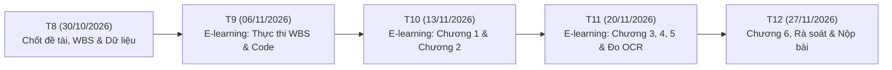

# 📅 Cấu trúc Công việc (WBS) & Đánh giá Tiến độ Theo Tuần

> [!NOTE]
> Tài liệu này theo dõi cấu trúc phân rã công việc (**WBS**) và kiểm tra tiến độ hàng tuần cho tiểu luận **Ứng dụng nhận diện biển số xe trong Hệ thống Giao thông Thông minh (ITS)**, bám sát lịch học E-learning từ Tuần 8 đến Tuần 12. Khi đẩy lên GitHub, toàn bộ các ô đánh dấu (`[x]` / `[ ]`), thanh đếm tiến độ và sơ đồ Mermaid sẽ hiển thị tương tác trực tiếp.

---

## 1. Sơ đồ Lộ trình Tổng quan Theo Tuần

---

## 2. Cấu trúc Phân rã Công việc (WBS) & Liên kết Mã nguồn

| Mã WBS | Gói công việc (Work Package) | Nội dung tiểu luận tương ứng | Tệp mã nguồn / Minh chứng trong Repo | Tuần thực hiện | Trạng thái |
| :---: | :--- | :--- | :--- | :---: | :---: |
| **WBS-1** | Tổng quan ITS, lý thuyết AI/CV/OCR & lập WBS | Phần I (Giới thiệu), Chương 1, Chương 2 | [`plate_app/docs/BAO_CAO_DU_AN.md`](plate_app/docs/BAO_CAO_DU_AN.md), [`plate_app/docs/GIAI_THICH.md`](plate_app/docs/GIAI_THICH.md) | T8 – T10 | ✅ Hoàn thành |
| **WBS-2** | Thu thập, làm sạch, chống rò rỉ & chia tập dữ liệu | Mục 3.1, 3.2 (Bảng 3.1, 3.2, Hình 3.1) | [`plate_app/prepare_data.py`](plate_app/prepare_data.py), [`plate_app/find_duplicates.py`](plate_app/find_duplicates.py), [`plate_app/split_dataset.py`](plate_app/split_dataset.py), [`plate_app/reports/source_stats.csv`](plate_app/reports/source_stats.csv) | T8 – T9 | ✅ Hoàn thành |
| **WBS-3** | Huấn luyện & đánh giá bộ phát hiện YOLOv8n | Mục 3.5.2, 4.2, 5.2 (Bảng 5.1, 5.2, Hình 5.1) | [`plate_app/train.py`](plate_app/train.py), [`plate_app/detect.py`](plate_app/detect.py), [`plate_app/evaluate.py`](plate_app/evaluate.py), [`plate_app/reports/compare_detectors.csv`](plate_app/reports/compare_detectors.csv), [`plate_app/reports/detector_failures_analysis.csv`](plate_app/reports/detector_failures_analysis.csv) | T9 | ✅ Hoàn thành |
| **WBS-4** | Tiền xử lý ảnh biển, EasyOCR & chuẩn hóa định dạng | Mục 3.5.4–3.5.6, 4.3, 5.3 (Bảng 5.3–5.6) | [`plate_app/preprocess.py`](plate_app/preprocess.py), [`plate_app/ocr.py`](plate_app/ocr.py), [`plate_app/validate.py`](plate_app/validate.py), [`plate_app/evaluate_ocr.py`](plate_app/evaluate_ocr.py), [`plate_app/reports/ocr_comparison.csv`](plate_app/reports/ocr_comparison.csv) | T9 – T11 | ✅ Hoàn thành |
| **WBS-5** | Theo dõi ID video, Best-Shot, Web UI Streamlit & SQLite | Mục 3.5.7, 3.5.8, 4.4, 4.5 (Hình 3.7–3.10, 4.2–4.4) | [`plate_app/video_tracker.py`](plate_app/video_tracker.py), [`plate_app/pipeline.py`](plate_app/pipeline.py), [`plate_app/database.py`](plate_app/database.py), [`plate_app/app.py`](plate_app/app.py), [`plate_app/ui_image.py`](plate_app/ui_image.py), [`plate_app/ui_video.py`](plate_app/ui_video.py), [`plate_app/ui_history.py`](plate_app/ui_history.py) | T9 – T11 | ✅ Hoàn thành |
| **WBS-6** | Đo tốc độ (GPU/Video FPS), phân tích ứng dụng ITS & hoàn thiện báo cáo | Mục 5.4, 5.5, Chương 6, Phần III & IV | [`plate_app/tools/bench_video.py`](plate_app/tools/bench_video.py), [`plate_app/tools/analyze_failures.py`](plate_app/tools/analyze_failures.py), [`plate_app/reports/hinh_bao_cao/`](plate_app/reports/hinh_bao_cao), [`plate_app/README.md`](plate_app/README.md) | T11 – T12 | 🔄 Đang hoàn thiện |

---

## 3. Chi tiết Tiến độ & Kiểm tra Theo Từng Tuần

> [!TIP]
> Trong mỗi tuần E-learning, nhóm tick trực tiếp vào ô `- [x]` khi hoàn thành đầu mục và đối chiếu cột **Minh chứng kiểm tra** trước khi chốt đánh giá tuần.

### 📌 T8 (30/10/2026) — Khởi động, Chốt WBS & Chuẩn bị Dữ liệu
> **Mục tiêu tuần:** Thống nhất phạm vi đề tài, phân công WBS, thiết lập môi trường Python/CUDA và chuẩn hóa 8.752 ảnh từ Kaggle + Roboflow.

- [x] Chốt tên đề tài, mục tiêu, phạm vi (không bao gồm biển đặc biệt quân đội/ngoại giao và triển khai Edge thực tế).
- [x] Phân công công việc cho từng thành viên theo bảng WBS (`WBS-1` đến `WBS-6`).
- [x] Gộp dữ liệu thô, đổi tên an toàn tiếng Việt và chuẩn hóa về 1 lớp `license_plate` ([`prepare_data.py`](plate_app/prepare_data.py)).
- [x] Loại ảnh trùng/gần trùng bằng MD5 + pHash (ngưỡng Hamming $\le 6$) và chia tập 80/10/10 theo nhóm ([`find_duplicates.py`](plate_app/find_duplicates.py), [`split_dataset.py`](plate_app/split_dataset.py)).

| Hạng mục kiểm tra | Sản phẩm / Minh chứng đối chiếu | Người phụ trách | Đánh giá |
| :--- | :--- | :---: | :---: |
| Thống kê 2 nguồn dữ liệu (498 Kaggle + 8.254 Roboflow) | [`plate_app/reports/source_stats.csv`](plate_app/reports/source_stats.csv) | TV1 | ✅ 100% |
| Kiểm tra không rò rỉ dữ liệu Train/Val/Test (MD5 & tên file) | [`plate_app/reports/duplicates.csv`](plate_app/reports/duplicates.csv), [`plate_app/reports/ratio_hist.png`](plate_app/reports/ratio_hist.png) | TV1 | ✅ 100% |

---

### 📌 T9 (06/11/2026) E-learning: làm việc nhóm
> **Nội dung E-learning:** *Mỗi thành viên trong nhóm thực hiện công việc đề tài tiểu luận theo WBS đã phân công.*

- [x] **Thành viên 1 (Dữ liệu & Phát hiện):** Huấn luyện thử `n640_quick` (3 epoch) và huấn luyện chính thức `n640` (dừng sớm ở epoch 69, tốt nhất epoch 54 — mAP50 = `0,9938`) bằng [`train.py`](plate_app/train.py).
- [x] **Thành viên 2 (Tiền xử lý & OCR/Validate):** Cài đặt module xoay thẳng Hough, cắt mép, CLAHE ([`preprocess.py`](plate_app/preprocess.py)), gom dòng EasyOCR ([`ocr.py`](plate_app/ocr.py)) và 31 ca tự kiểm định dạng ([`validate.py`](plate_app/validate.py)).
- [x] **Thành viên 3 (Video Tracking, Giao diện & CSDL):** Xây dựng bộ theo dõi ID + chọn ảnh Best-Shot ([`video_tracker.py`](plate_app/video_tracker.py)), lưu trữ SQLite ([`database.py`](plate_app/database.py)) và 3 tab Streamlit ([`app.py`](plate_app/app.py)).
- [x] Xây dựng bộ 150 ảnh cắt từ tập test để đánh giá OCR và loại 7 ảnh trùng minh họa còn 143 ảnh ([`plate_app/tools/make_ocr_labelset.py`](plate_app/tools/make_ocr_labelset.py)).

| Thành viên | Công việc WBS được giao trong T9 | Minh chứng mã nguồn / Kết quả | Mức hoàn thành |
| :---: | :--- | :--- | :---: |
| **TV1** | Huấn luyện & đánh giá YOLO (`WBS-3`) | [`plate_app/reports/train_results.md`](plate_app/reports/train_results.md), [`plate_app/reports/compare_detectors.csv`](plate_app/reports/compare_detectors.csv) | ✅ Đạt (100%) |
| **TV2** | Tiền xử lý, EasyOCR, `validate.py` (`WBS-4`) | [`plate_app/preprocess.py`](plate_app/preprocess.py), [`plate_app/validate.py`](plate_app/validate.py) (31/31 ca test đạt) | ✅ Đạt (100%) |
| **TV3** | Video tracker, Streamlit 3 tab, SQLite (`WBS-5`) | [`plate_app/video_tracker.py`](plate_app/video_tracker.py), [`plate_app/ui_image.py`](plate_app/ui_image.py), [`plate_app/ui_video.py`](plate_app/ui_video.py), [`plate_app/ui_history.py`](plate_app/ui_history.py) | ✅ Đạt (100%) |

---

### 📌 T10 (13/11/2026) E-learning: làm việc nhóm
> **Nội dung E-learning:** *Hoàn thiện tiểu luận: Chương 1 - Tổng quan đề tài; Chương 2 - Cơ sở lý thuyết.*

- [x] Hoàn thiện **Phần I (Giới thiệu)**: Lý do chọn đề tài, mục tiêu, đối tượng/phạm vi, phương pháp nghiên cứu.
- [x] Hoàn thiện **Chương 1 (Tổng quan về ITS và nhận diện biển số xe)**: Khái niệm ITS, ánh xạ 9 nhóm dịch vụ tiện ích ITS (Bảng 1.1 đối chiếu Bài giảng 01), vai trò Computer Vision/VIP (Bài giảng 02, 03), tổng quan ALPR và ứng dụng thực tế.
- [x] Hoàn thiện **Chương 2 (Cơ sở lý thuyết và công nghệ)**: Tiền xử lý ảnh (xám, Bicubic, CLAHE, Otsu, Canny/Hough, Laplacian), Deep Learning/Transfer Learning, chỉ số IoU/Precision/Recall/mAP, cơ chế CRAFT+CRNN của EasyOCR, CER/Levenshtein và bảng so sánh lựa chọn công nghệ (Mục 2.5).
- [x] Sửa lỗi lệch khung xanh trên ảnh Best-Shot trong [`video_tracker.py`](plate_app/video_tracker.py) & [`pipeline.py`](plate_app/pipeline.py); xuất đủ bộ ảnh minh họa cho Chương 3 & Chương 4 tại [`plate_app/reports/hinh_bao_cao/`](plate_app/reports/hinh_bao_cao).

| Hạng mục kiểm tra | Minh chứng đối chiếu | Người kiểm tra | Đánh giá |
| :--- | :--- | :---: | :---: |
| Nội dung Phần I, Chương 1, Chương 2 bám sát Bài giảng 01–05 | Bản thảo tiểu luận (Mục I, Chương 1, Chương 2) | TV1 & TV2 | ✅ Đạt |
| Bộ hình minh họa giao diện & quy trình (Hình 3.1 – 4.4) | [`plate_app/reports/hinh_bao_cao/`](plate_app/reports/hinh_bao_cao) | TV3 | ✅ Đạt |

---

### 📌 T11 (20/11/2026) E-learning: làm việc nhóm *(Tuần hiện tại)*
> **Mục tiêu tuần:** Hoàn thiện toàn bộ số liệu thực nghiệm Chương 5 (OCR, phân loại lỗi YOLO, tốc độ GPU & Video FPS), đồng bộ Chương 3–4–6 và chuẩn hóa tài liệu repo.

- [x] Gán nhãn chuỗi đúng cho tập đánh giá OCR (122 biển đọc được: 83 `dev`, 39 `final`; 21 biển mờ) tại [`plate_app/data/ocr_labels.csv`](plate_app/data/ocr_labels.csv).
- [x] Chạy thực nghiệm [`evaluate_ocr.py`](plate_app/evaluate_ocr.py) để điền **Bảng 5.3 – 5.6**: so sánh Raw/CLAHE/Otsu, ablation 4 luật sửa ký tự và ablation tiền xử lý ([`ocr_comparison.csv`](plate_app/reports/ocr_comparison.csv), [`ocr_ablation.csv`](plate_app/reports/ocr_ablation.csv), [`ocr_ablation_preprocess.csv`](plate_app/reports/ocr_ablation_preprocess.csv)).
- [x] Phân tích định lượng 22 ảnh lỗi phát hiện `best_n640.pt` ([`analyze_failures.py`](plate_app/tools/analyze_failures.py)) và xuất Hình 5.1 ([`export_hinh_5_1.py`](plate_app/tools/export_hinh_5_1.py)).
- [x] Đo tốc độ toàn luồng trên 50 ảnh `val` (trung vị `34,57 ms`) và đo FPS video thực tế bằng [`bench_video.py`](plate_app/tools/bench_video.py) (đạt `35,9–75,7 FPS`, giảm `59,2–88,9%` số lượt gọi OCR).
- [ ] Thành viên trong nhóm rà soát đối chiếu lại cột nhãn `text` trong [`ocr_labels.csv`](plate_app/data/ocr_labels.csv) và kiểm tra đường dẫn/năm truy cập tài liệu tham khảo.
- [ ] Cập nhật đầy đủ số liệu Bảng 5.3–5.6, Hình 5.1 và phân tích vào file Word tiểu luận chính thức.

| Hạng mục kiểm tra | Kết quả đo / Minh chứng | Phụ trách | Trạng thái |
| :--- | :--- | :---: | :---: |
| Thực nghiệm OCR `dev` (83 biển) & `final` (39 biển) | `38,55%` (dev) / `33,33%` (final) / `58,82%` (>60px) — [`ocr_comparison.csv`](plate_app/reports/ocr_comparison.csv) | TV2 | ✅ Đã đo |
| Phân loại 22 ảnh lỗi YOLO (`best_n640.pt`) | 11 thiếu nhãn mép ảnh, 4 biển <25px, 3 lệch IoU, 3 nhầm vật thể, 1 khuất mép — [`detector_failures_analysis.csv`](plate_app/reports/detector_failures_analysis.csv) | TV1 | ✅ Đã đo |
| Đo tốc độ GPU & Video FPS (`bench_video.py`) | 50 ảnh val: `34,57 ms`; Video: `35,9–75,7 FPS` | TV3 | ✅ Đã đo |
| Rà soát chéo file Word sau khi điền đủ bảng | File `.docx` tiểu luận bản sạch | Cả nhóm | 🔄 Chờ xác nhận |

---

### 📌 T12 (27/11/2026) — Tổng hợp, Rà soát Cuối & Nộp Tiểu luận
> **Mục tiêu tuần:** Kiểm tra chéo toàn bộ báo cáo, xóa ghi chú nháp, chuẩn bị bộ slide & demo trực tiếp trên Streamlit.

- [ ] Điền đầy đủ thông tin trang bìa (Họ tên, MSSV, Lớp, Giảng viên), bổ sung số liệu phương tiện giao thông & nguồn trích dẫn ở Phần I.1.
- [ ] Xóa toàn bộ đoạn *"Ghi chú cho bản nháp"* và các dấu `[...]` còn sót trong file Word.
- [ ] Chạy kiểm tra cuối cùng ứng dụng Streamlit (`python -m streamlit run app.py`) qua 3 tab Ảnh, Video và Lịch sử.
- [ ] Chuẩn bị Slide thuyết trình và phân công trả lời nhóm câu hỏi thảo luận (Phần IV — 25 câu hỏi).
- [ ] Đẩy toàn bộ mã nguồn, tài liệu và file báo cáo hoàn chỉnh lên GitHub & nộp bài đúng hạn.

---

## 4. Bảng Tổng hợp Đánh giá & Chấm điểm Tiến độ Thành viên (Cập nhật hàng tuần)

| Tuần | Mục tiêu chính | TV1 (%) | TV2 (%) | TV3 (%) | Tiến độ chung | Ghi chú / Vấn đề tồn đọng |
| :---: | :--- | :---: | :---: | :---: | :---: | :--- |
| **T8 (30/10)** | Chốt WBS, làm sạch & chia tập 8.752 ảnh | 100% | 100% | 100% | **100%** | Không phát hiện rò rỉ dữ liệu (`PASS`) |
| **T9 (06/11)** | Làm việc nhóm theo WBS: YOLO, OCR, Web App | 100% | 100% | 100% | **100%** | Hoàn thành 100% pipeline xử lý ảnh & video |
| **T10 (13/11)** | Hoàn thiện Chương 1 & Chương 2 tiểu luận | 100% | 100% | 100% | **100%** | Đã sửa lệch `best_bbox` và xuất ảnh minh họa |
| **T11 (20/11)** | Đo OCR, phân loại lỗi YOLO, FPS & Chương 5 | 95% | 90% | 95% | **93%** | Cần rà chéo lại nhãn [`ocr_labels.csv`](plate_app/data/ocr_labels.csv) & dán vào Word |
| **T12 (27/11)** | Rà soát cuối, Slide thuyết trình & Nộp bài | 0% | 0% | 0% | **0%** | Chưa đến hạn tuần 12 |

---

## 5. Mẫu Phiếu Kiểm tra / Đánh giá Cuối mỗi Tuần (Dùng cho Nhóm trưởng)

Khi kết thúc mỗi tuần (hoặc mỗi lần commit lên GitHub), nhóm trưởng đối chiếu 4 câu hỏi nhanh dưới đây:

1. **Đúng hạn (Timeline):** Các đầu việc `- [ ]` trong tuần đã được chuyển thành `- [x]` đúng hạn thứ Sáu chưa?
2. **Có minh chứng (Artifact):** Mỗi công việc hoàn thành đã gắn kèm link tới file code, file `.csv` kết quả hoặc ảnh minh họa trong repo chưa?
3. **Tính trung thực số liệu:** Mọi con số đưa vào báo cáo có khớp trực tiếp với file log/CSV trong [`plate_app/reports/`](plate_app/reports) không?
4. **Hành động tuần tiếp theo:** Có hạng mục nào bị trễ phải chuyển sang tuần kế tiếp không? (Ghi rõ vào cột *Ghi chú / Vấn đề tồn đọng*).
