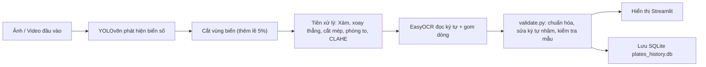
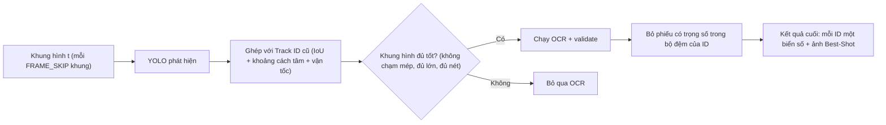

# BÁO CÁO TỔNG HỢP DỰ ÁN: NHẬN DIỆN BIỂN SỐ XE VIỆT NAM TRONG HỆ THỐNG GIAO THÔNG THÔNG MINH (ITS)

- **Thư mục dự án:** `D:\ITS` (mã nguồn chính ở `D:\ITS\plate_app`)
- **Ngày lập báo cáo:** 31/10/2026
- **Phần cứng đã dùng:** Laptop GPU NVIDIA GeForce RTX 3050 6GB, Windows, Python 3.11

> **Nguyên tắc của báo cáo:** mọi con số lấy từ file kết quả có thật trong dự án (`reports/train_results.md`, `reports/compare_detectors.csv`, `reports/source_stats.csv`, `data/ocr_labels.csv`, `data/plates_history.db`) hoặc từ lệnh tự kiểm tra. Phần nào **chưa đo** thì ghi rõ là chưa đo.

---

## MỤC LỤC

1. Tổng quan và mục tiêu
2. Kiến trúc luồng xử lý (pipeline)
3. Cấu trúc thư mục và tác dụng từng thư mục / từng file
4. Quy trình đã thực hiện theo từng giai đoạn
5. Kết quả đạt được
6. Các lỗi đã gặp và cách khắc phục
7. Hạn chế và những gì chưa kiểm chứng
8. Hướng dẫn thực thi (từng lệnh)
9. Đề xuất bước tiếp theo

---

## 1. TỔNG QUAN VÀ MỤC TIÊU

Xây dựng một ứng dụng hoàn chỉnh nhận diện biển số xe Việt Nam từ **ảnh tĩnh** và **video**, gồm:

- Phát hiện vị trí biển số bằng mô hình **YOLOv8n** tự huấn luyện.
- Đọc ký tự trên biển bằng **EasyOCR**.
- Kiểm tra và sửa lỗi định dạng biển số theo các dạng biển dân sự phổ biến.
- Theo dõi biển số qua các khung hình video (gắn `ID #`), bỏ phiếu chọn kết quả.
- Giao diện web **Streamlit** (3 tab: Ảnh / Video / Lịch sử) và lưu lịch sử vào **SQLite**.

---

## 2. KIẾN TRÚC LUỒNG XỬ LÝ



Với video, có thêm bước **theo dõi (tracking)** giữa B và D:



---

## 3. CẤU TRÚC THƯ MỤC VÀ TÁC DỤNG

### 3.1. Thư mục gốc `D:\ITS`

| Thư mục / File | Tác dụng |
|---|---|
| `ITS/` | **Dữ liệu thô tải về** (chưa xử lý). Gồm 3 thư mục con bên dưới. |
| `ITS/kaggle_vnlp/` | Bộ dữ liệu biển số Việt Nam từ Kaggle (ảnh chủ yếu 1920×1080). Dùng để train. |
| `ITS/roboflow_cuongta/` | Bộ dữ liệu "Vietnamese Car License Plate" xuất từ Roboflow định dạng YOLOv8 (ảnh chủ yếu 472×303). Dùng để train. |
| `ITS/unused_vehicles/` | Bộ dữ liệu phương tiện **không dùng** trong dự án (nhãn là xe, không phải biển số) — để riêng cho khỏi lẫn. |
| `plate_app/` | **Toàn bộ mã nguồn ứng dụng** (mô tả chi tiết ở mục 3.2). |
| `runs/detect/val`, `val-2` … `val-9` | Thư mục ultralytics tự sinh khi chạy đánh giá (`model.val`) lúc thư mục làm việc là `D:\ITS`. Chỉ là kết quả phụ (biểu đồ, ma trận nhầm lẫn), có thể xóa. |
| `weights/yolo26n.pt` | File trọng số tải về, **không được dùng** trong luồng hiện tại (mô hình dùng là `plate_app/models/best_n640.pt`). |
| `yolov8n.pt` | Trọng số gốc YOLOv8n (huấn luyện sẵn trên COCO) do ultralytics tự tải, dùng làm **điểm khởi đầu** khi train. |
| `README.md` | Hướng dẫn khởi chạy nhanh, trỏ vào `plate_app/README.md`. |

### 3.2. Thư mục ứng dụng `D:\ITS\plate_app`

#### a) Các thư mục con

| Thư mục | Tác dụng | Nội dung hiện có |
|---|---|---|
| `data/` | Chứa dữ liệu đã xử lý, cấu hình dataset, CSDL và kết quả chạy. | xem bảng b) |
| `data/processed/all/` | Ảnh + nhãn của **cả 2 nguồn đã gộp lại** sau khi kiểm tra hợp lệ (đổi tên `kaggle_xxxxx`, `roboflow_xxxxx`). | 8.752 ảnh + 8.752 nhãn |
| `data/processed/split/` | Dữ liệu đã **chia train/val/test** theo cụm ảnh trùng (chống rò rỉ dữ liệu). Mỗi tập có `images/` và `labels/`. | train 7.001 / val 876 / test 875 |
| `data/ocr_set/` | 150 ảnh biển số đã cắt từ tập **test**, lấy mẫu phân tầng, dùng làm **bộ kiểm thử OCR**. | 150 ảnh |
| `data/results/` | Ảnh gốc, ảnh biển cắt, khung hình video, video kết quả `.webm` được lưu khi chạy giao diện. Đường dẫn các file này được ghi vào SQLite. | ~550 file |
| `models/` | Trọng số YOLO đã huấn luyện. | `best_n640.pt` (bản chính), `best_n640_quick.pt` (chạy thử 3 epoch) |
| `runs/detect/n640`, `n640_quick` | Thư mục ultralytics sinh ra khi **train**: `weights/`, `results.png`, `confusion_matrix.png`, `PR_curve.png`, `results.csv`… | 2 lần chạy |
| `runs/train_n640.log` | Nhật ký đầy đủ quá trình train bản chính. | ~4,9 MB |
| `reports/` | Các **báo cáo, bảng số liệu, ảnh minh họa** sinh ra trong quá trình làm. | xem bảng c) |
| `reports/detector_failures/` | Ảnh mà mô hình **bỏ sót** hoặc **báo nhầm** biển số trên tập test, tách theo từng trọng số. | `best_n640/` 22 ảnh, `best_n640_quick/` 54 ảnh |
| `reports/duplicate_samples/` | Ảnh mẫu các cặp ảnh trùng/gần trùng để kiểm tra bằng mắt. | 10 ảnh |
| `tools/` | Các **công cụ phụ trợ** chạy độc lập (thống kê, gán nhãn, dọn CSDL). | xem bảng e) |
| `docs/` | **Tài liệu**: giải thích thuật toán, ghi chú, báo cáo này. | 3 file |

#### b) Các file trong `data/`

| File | Tác dụng |
|---|---|
| `data.yaml` | Khai báo dataset cho YOLO: đường dẫn `split/`, `nc: 1`, `names: ['license_plate']`. |
| `ocr_labels.csv` | Danh sách 150 biển của `ocr_set/` với các cột `file, source, plate_type, height_px, height_bucket, subset (dev/final), text, readable, excluded`. Hiện **0/150 biển đã có nhãn**; 7 dòng `excluded = 1` (xem mục 4.6). |
| `plates_history.db` | CSDL SQLite chứa bảng `detections` (lịch sử nhận diện). Hiện có 273 bản ghi, phần lớn là chạy thử. |
| `plates_history_backup.db` | Bản sao lưu tự tạo khi bấm nút / chạy script xóa dữ liệu thử (chỉ xuất hiện sau khi dùng chức năng này). |
| `history.db` | File rỗng (0 byte) còn sót từ lần đặt tên CSDL cũ, không được dùng — có thể xóa. |
| `test_kaggle.txt`, `test_roboflow.txt` | Danh sách ảnh test theo từng nguồn (50 và 825 ảnh) để đánh giá riêng từng nguồn. |

#### c) Các file trong `reports/`

| File | Tác dụng |
|---|---|
| `source_stats.csv` | Thống kê từng nguồn: số ảnh nhận, số ảnh loại, số biển/ảnh, tỉ lệ rộng/cao. |
| `dropped.csv` | Danh sách ảnh bị loại khi chuẩn bị dữ liệu (hiện rỗng — không loại ảnh nào). |
| `duplicates.csv` | 4.550 cặp ảnh trùng tuyệt đối (MD5) / gần trùng (pHash ≤ 6). |
| `big_group_sample.jpg` | Ảnh mẫu của nhóm trùng lớn nhất (để kiểm tra hiện tượng "gom thừa"). |
| `ratio_hist.png` | Biểu đồ tỉ lệ rộng/cao của biển số, dùng để chọn ngưỡng `TWO_LINE_RATIO = 2.1`. |
| `io_test_sample.jpg` | Ảnh kiểm tra đọc/ghi đường dẫn tiếng Việt. |
| `preprocess_demo.jpg` | Minh họa 4 bước tiền xử lý trên 6 biển (3 vuông, 3 dài). |
| `train_results.md` | Kết quả từng lần train (cấu hình, val/test, tách theo nguồn, tốc độ). |
| `compare_detectors.csv` | So sánh 2 trọng số: precision, recall, mAP, recall theo chiều cao biển, ms/ảnh. |
| `ocr_comparison.csv`, `ocr_ablation.csv`, `ocr_raw_cache.csv`, `ocr_ablation_preprocess.csv` | **Chưa có** — chỉ sinh ra sau khi gán nhãn OCR và chạy `evaluate_ocr.py`. |

#### d) Các file mã nguồn chính (theo giai đoạn)

| Giai đoạn | File | Số dòng | Tác dụng |
|---|---|---:|---|
| Dùng chung | `config.py` | 108 | Mọi hằng số: đường dẫn, ngưỡng YOLO/OCR, tham số tiền xử lý, `FRAME_SKIP`, mẫu biển số `PLATE_PATTERNS`, các **công tắc luật** (`MAX_FIXED_CHARS`, `RULE_*`). |
| Dùng chung | `image_io.py` | 54 | Đọc/ghi ảnh an toàn với đường dẫn tiếng Việt (`np.fromfile` + `cv2.imdecode`). |
| 0 – Dữ liệu | `prepare_data.py` | 131 | Kiểm tra cặp ảnh–nhãn của 2 nguồn, loại ảnh hỏng/thiếu nhãn, gộp vào `data/processed/all/`, xuất `source_stats.csv`. |
| 0 – Dữ liệu | `find_duplicates.py` | 114 | Tìm ảnh trùng bằng MD5 và gần trùng bằng pHash, xuất `duplicates.csv`. |
| 0 – Dữ liệu | `split_dataset.py` | 153 | Gom nhóm ảnh trùng bằng Union-Find, chia 80/10/10 theo nhóm và theo nguồn, sinh `data.yaml`. |
| 1 – Tiền xử lý | `preprocess.py` | 122 | Chuyển xám → xoay thẳng (Hough) → cắt 4,5% mép biển dài → phóng to giữ tỉ lệ (cao ≥ 100px) → CLAHE → (tùy chọn) Otsu. |
| 2 – Phát hiện | `train.py` | 151 | Huấn luyện YOLOv8n, ghi kết quả vào `reports/train_results.md`. |
| 2 – Phát hiện | `detect.py` | 94 | Tải model, phát hiện biển, cắt biển (lề 5%), vẽ khung kèm nhãn. |
| 2 – Phát hiện | `evaluate_utils.py` | 118 | Tính IoU, ghép cặp tham lam (TP/FP/FN), vẽ ảnh lỗi. Tự kiểm tra 11/11 PASS. |
| 2 – Phát hiện | `evaluate.py` | 117 | Đánh giá các trọng số trên tập test, recall theo chiều cao/nguồn, xuất `compare_detectors.csv`. |
| 3 – OCR | `ocr.py` | 128 | Khởi tạo EasyOCR, đọc chữ, gom hộp chữ thành dòng, đọc lại 2 nửa với biển vuông. |
| 3 – OCR | `validate.py` | 208 | Chuẩn hóa chuỗi, sửa ký tự nhầm theo vị trí, kiểm tra mẫu biển. Tự kiểm tra **31/31 PASS** (22 ca gốc + 9 ca từ clip). |
| 3 – OCR | `evaluate_ocr.py` | 294 | Đánh giá OCR (khớp cả biển, CER), cache chữ OCR thô, ablation luật validate và ablation tiền xử lý. |
| 4 – Luồng xử lý | `database.py` | 143 | SQLite: tạo bảng, lưu, lọc, thống kê, xóa, sao lưu & xóa toàn bộ. |
| 4 – Luồng xử lý | `pipeline.py` | 238 | `process_image` (ảnh) và `process_video` (video: tracking, OCR có chọn lọc, bỏ phiếu, xuất video). |
| 4 – Luồng xử lý | `video_tracker.py` | 179 | Theo dõi biển qua các khung (ID #), lọc Best-Shot, bỏ phiếu có trọng số, vẽ khung lên video. |
| 5 – Giao diện | `app.py` | 93 | Trang chính Streamlit: thanh bên cấu hình + 3 tab. Tự gọi `streamlit run` nếu chạy bằng `python app.py`. |
| 5 – Giao diện | `ui_image.py` | 112 | Tab Ảnh: tải nhiều ảnh, vẽ khung, xem ảnh cắt/tiền xử lý, sửa tay, xuất CSV. |
| 5 – Giao diện | `ui_video.py` | 95 | Tab Video: thanh tiến trình, video kết quả, ảnh Best-Shot từng ID, bảng tổng hợp. |
| 5 – Giao diện | `ui_history.py` | 80 | Tab Lịch sử: thống kê, lọc, xem chi tiết, xóa bản ghi, nút sao lưu & xóa dữ liệu thử. |

#### e) Các công cụ trong `tools/`

| File | Tác dụng |
|---|---|
| `plot_ratio.py` | Vẽ `reports/ratio_hist.png` (phân bố tỉ lệ rộng/cao biển số). |
| `image_sizes.py` | Thống kê kích thước ảnh gốc và chiều cao biển số theo nguồn. |
| `make_ocr_labelset.py` | Sinh 150 ảnh `data/ocr_set/` + `data/ocr_labels.csv` (phân tầng 12 ô, chia dev/final). |
| `label_tool.py` | Giao diện Streamlit gõ nhãn OCR; bỏ qua dòng `excluded = 1`; hiển thị số biển còn phải gán của dev và final riêng. |
| `clear_history.py` | Sao lưu `plates_history.db` → `plates_history_backup.db` rồi xóa toàn bộ dữ liệu thử. |

#### f) Tài liệu trong `docs/`

| File | Tác dụng |
|---|---|
| `GIAI_THICH.md` | Giải thích từng thuật toán bằng ngôn ngữ đời thường kèm ví dụ số (MD5, pHash, Union-Find, CLAHE, Otsu, IoU, mAP, Levenshtein, bỏ phiếu…). Dùng cho chương lý thuyết và thảo luận. |
| `NOTES_CHO_GIAI_DOAN_3.md` | Ghi chú các hạng mục dời từ giai đoạn 2 sang giai đoạn 3. |
| `BAO_CAO_DU_AN.md` | Báo cáo tổng hợp này. |

---

## 4. QUY TRÌNH ĐÃ THỰC HIỆN THEO TỪNG GIAI ĐOẠN

### 4.1. Giai đoạn 0 — Chuẩn bị và chia dữ liệu

1. **Kiểm tra và gộp dữ liệu** (`prepare_data.py`): duyệt 2 nguồn, kiểm tra ảnh đọc được, có nhãn, nhãn đúng định dạng YOLO. Kết quả: kaggle 498 ảnh, roboflow 8.254 ảnh, **không loại ảnh nào**.

   | Nguồn | Số ảnh | Số biển TB/ảnh | Tỉ lệ rộng/cao trung vị | % biển vuông (w/h < 2) |
   |---|---:|---:|---:|---:|
   | kaggle | 498 | 1,566 | 1,305 | 80,51% |
   | roboflow | 8.254 | 1,023 | 2,429 | 44,04% |

2. **Tìm ảnh trùng** (`find_duplicates.py`): MD5 cho trùng tuyệt đối, pHash (ngưỡng ≤ 6) cho gần trùng → 4.550 cặp.
3. **Chia tập** (`split_dataset.py`): gom nhóm trùng bằng Union-Find, chia theo nhóm để ảnh cùng một xe không rơi vào cả train lẫn test. Kết quả: **train 7.001 / val 876 / test 875**, kiểm tra chéo tên file và MD5 giữa các tập: 0 ảnh trùng.
4. **Thống kê phụ** (`tools/plot_ratio.py`, `tools/image_sizes.py`): chọn ngưỡng `TWO_LINE_RATIO = 2.1` để phân biệt biển 1 dòng và 2 dòng.

### 4.2. Giai đoạn 1 — Tiền xử lý ảnh biển số

Chuỗi xử lý trong `preprocess.py`:

1. Chuyển ảnh xám.
2. Xoay thẳng theo góc trung vị của các đường viền ngang (Canny + HoughLinesP) — công tắc `RULE_STRAIGHTEN`.
3. Với biển dài 1 dòng: cắt 4,5% hai mép trái/phải và 4% trên/dưới để bỏ viền kim loại — công tắc `RULE_TRIM_EDGE`.
4. Phóng to giữ tỉ lệ khi chiều cao < 100px (nội suy Bicubic).
5. Tăng tương phản cục bộ CLAHE (clip 2.0, lưới 8×8).
6. (Tùy chọn) Gaussian Blur + nhị phân Otsu — mặc định **tắt**.

Ảnh minh họa: `reports/preprocess_demo.jpg`.

### 4.3. Giai đoạn 2 — Huấn luyện và đánh giá bộ phát hiện

- Cấu hình: `yolov8n.pt`, ảnh 640, batch 16, workers 2, patience 15, seed 42.

| Lần chạy | Epoch (đặt/thực) | Thời gian | Precision | Recall | mAP50 | mAP50-95 | ms/ảnh |
|---|---|---:|---:|---:|---:|---:|---:|
| `n640_quick` | 3/3 | 5,06 phút | 0,9810 | 0,9628 | 0,9800 | 0,6855 | 3,39 |
| **`n640` (chính thức)** | 80/69 (tốt nhất epoch 54) | 83,18 phút | **0,9967** | **0,9846** | **0,9938** | **0,7340** | 3,55 |

*(Đo trên tập test. ms/ảnh lấy từ `compare_detectors.csv`.)*

**Recall theo chiều cao biển (%):**

| Model | < 30px | 30–60px | > 60px |
|---|---:|---:|---:|
| best_n640.pt | 96,03 | 99,69 | 100,0 |
| best_n640_quick.pt | 93,25 | 98,13 | 100,0 |

**Theo nguồn (n640):** kaggle mAP50 0,9488 / recall 0,9189 (chỉ 50 ảnh test, dao động mạnh) · roboflow mAP50 0,9950 / recall 0,9905.

Số ảnh có lỗi phát hiện giảm từ 54 (bản chạy thử) xuống 22 (bản chính), lưu ở `reports/detector_failures/`.

### 4.4. Giai đoạn 3 — Nhận dạng ký tự và kiểm tra định dạng

1. **`ocr.py`:**
   - EasyOCR khởi tạo một lần, chỉ cho phép `0-9 A-Z Đ - .`, bỏ kết quả có độ tin cậy < 0,30.
   - Gom các hộp chữ thành dòng theo tâm dọc; hai hộp chồng nhau theo chiều ngang > 25% thì bắt buộc ở 2 dòng khác nhau (chống đảo dòng khi biển nghiêng).
   - Biển vuông chưa đọc ra kết quả hợp lệ: cắt nửa trên (0–55%) và nửa dưới (45–100%) để đọc lại — công tắc `RULE_TWO_HALVES`.

2. **`validate.py`:**
   - Các mẫu hỗ trợ dựa trên định dạng biển phổ biến quan sát được, **chưa đối chiếu văn bản quy định**: ô tô 5 số `30A-123.45`, ô tô 4 số `30A-1234`, xe máy 5 số `59-X1 123.45` / `43-AA 567.89`, xe máy 4 số `29-L1 1234`.
   - Sửa ký tự nhầm theo vị trí (vị trí cần số / cần chữ), tối đa `MAX_FIXED_CHARS = 3` ký tự, mã tỉnh phải trong 11–99; không khớp mẫu nào thì giữ nguyên và đánh dấu không hợp lệ.
   - Bảng ánh xạ đúng như trong code:
     - `BASE_TO_DIGIT = {O→0, D→0, I→1, Z→2, S→5, G→6, B→8}`
     - `EXTRA_TO_DIGIT = {Q→0, U→0, J→3, L→4, T→7}` (công tắc `RULE_EXTRA_DIGIT_MAP`)
     - `TO_ALPHA = {0→O, 1→I, 2→Z, 4→A, 5→S, 6→G, 8→B}`
   - Các nhóm luật thêm sau từ lỗi thực tế, mỗi nhóm có công tắc riêng trong `config.py`:

     | Công tắc | Luật | Ra đời từ ca |
     |---|---|---|
     | `RULE_STRIP_WATERMARK` | Xóa chữ `TIKTOK`/`TKTOK` | Clip TikTok có logo đè lên biển |
     | `RULE_SWAP_INVERTED_LINES` | Đảo lại khi dòng số `XXX.XX` bị đọc trước dòng mã tỉnh | Clip TikTok biển nghiêng (`865.8660-AA`) |
     | `RULE_TRIM_TRAILING_BORDER` | Bỏ 1 ký tự `[17IJT]` thừa sau `.XX` | Ảnh Honda City (`616-516.027`) |
     | `RULE_EXTRA_DIGIT_MAP` | Ánh xạ thêm Q/U/J/L/T sang số | Clip TikTok (`60-AK 21L.10`, `6U-B8 935.88`) |

   - Bộ tự kiểm tra: **Nhóm gốc 22/22 PASS, nhóm từ clip 9/9 PASS, tổng 31/31**.

3. **`evaluate_ocr.py`** (đã viết, **chưa chạy được vì chưa có nhãn**):
   - Chữ OCR thô tính **một lần** rồi lưu `reports/ocr_raw_cache.csv`; các phép so sánh validate chỉ chạy lại `validate_plate`, không chạy lại EasyOCR.
   - So sánh 3 chế độ tiền xử lý (`raw`, `clahe`, `threshold`) × có/không validate → `ocr_comparison.csv`.
   - Ablation luật validate trên tập dev (a: không validate; b: `MAX_FIXED_CHARS = 1`; c: hiện tại; d1–d4: tắt từng nhóm luật) → `ocr_ablation.csv`, có cột quan trọng **tỉ lệ biển được đánh dấu hợp lệ nhưng đọc sai**.
   - `--ablate-preprocess`: chạy lại EasyOCR với từng cấu hình bật/tắt `RULE_STRAIGHTEN`, `RULE_TRIM_EDGE`, `RULE_TWO_HALVES` → `ocr_ablation_preprocess.csv`.
   - `--final`: chỉ chạy **một lần duy nhất** khi chốt số liệu báo cáo.

### 4.5. Giai đoạn 4 — CSDL và luồng xử lý

- **`database.py`**: bảng `detections` gồm thời gian, nguồn, tên file, chuỗi thô/chuẩn hóa, hợp lệ, đã sửa tay, loại biển, mã tỉnh, độ tin cậy, đường dẫn ảnh, thời gian xử lý. Mọi truy vấn dùng tham số `?` (chống SQL Injection). Có hàm `backup_and_clear_history` sao lưu trước khi xóa.
- **`pipeline.py`**:
  - `process_image`: phát hiện → cắt → tiền xử lý → OCR → validate, ghi thời gian từng bước.
  - `process_video`: xử lý mỗi `FRAME_SKIP = 3` khung, theo dõi, OCR có chọn lọc, bỏ phiếu, gộp các ID trùng biển, xuất video `.webm` (VP8).
- **`video_tracker.py`**:
  - Ghép biển giữa các khung bằng IoU, khoảng cách tâm và vận tốc ước lượng.
  - Chỉ chạy OCR khi biển không chạm mép (≥ 6px), đủ lớn (≥ 36×16px), đủ nét (Laplacian ≥ 22). Mỗi ID có 5 lần đọc hợp lệ (độ tin cậy ≥ 0,55) thì khóa, không đọc nữa.
  - Bỏ phiếu theo trọng số `det_conf × ocr_conf × hệ số hợp lệ`.
  - Lưu ảnh Best-Shot cùng **tọa độ khung của chính khung hình đó** (`best_bbox`) — đã sửa lỗi khung bị lệch (mục 6).

### 4.6. Kiểm soát rò rỉ dữ liệu cho bộ kiểm thử OCR

- 150 ảnh `ocr_set/` chia **dev 101 / final 49**. Chỉnh luật chỉ được dựa trên dev; final chạy một lần ở cuối.
- Đã đối chiếu (bằng tên file và pHash) các ảnh từng dùng khi chỉnh luật/demo với `ocr_set/`:
  - 6 ảnh/clip ngoài (Honda City, ảnh 2 siêu xe, ảnh Honda 150i, 3 clip TikTok): **0 file trùng**.
  - Ảnh test từng dùng trong demo `detect.py`/`pipeline.py`/`preprocess.py`: **7 file trùng** → đã đánh dấu `excluded = 1` trong `ocr_labels.csv` (`ocr_009`, `ocr_018`, `ocr_024`, `ocr_031`, `ocr_040`, `ocr_041`, `ocr_102`). `evaluate_ocr.py` và `label_tool.py` tự bỏ qua các dòng này.

### 4.7. Giai đoạn 5 — Giao diện Streamlit

- **Thanh bên:** ngưỡng phát hiện (mặc định 0,40), bật/tắt tiền xử lý, tự động lưu SQLite.
- **Tab Ảnh:** tải nhiều ảnh, vẽ khung + biển số, xem ảnh cắt và ảnh sau tiền xử lý, sửa tay rồi lưu, xuất CSV.
- **Tab Video:** thanh tiến trình, phát video kết quả có `ID # | biển số`, ảnh Best-Shot từng ID, bảng tổng hợp.
- **Tab Lịch sử:** thống kê, lọc theo biển/ngày/nguồn/hợp lệ, xem ảnh, xóa bản ghi, nút **sao lưu & xóa dữ liệu thử**.
- Model YOLO và EasyOCR chỉ tải một lần (`st.cache_resource`).

---

## 5. KẾT QUẢ ĐẠT ĐƯỢC

| Hạng mục | Trạng thái |
|---|---|
| Chuẩn bị và chia dữ liệu | ✅ 8.752 ảnh → 7.001 / 876 / 875, không rò rỉ giữa các tập |
| Bộ phát hiện YOLOv8n | ✅ test mAP50 = 0,9938, recall = 0,9846, ~3,5 ms/ảnh |
| Tiền xử lý | ✅ Có ảnh minh họa; các bước thêm sau có công tắc bật/tắt |
| OCR + kiểm tra định dạng | ✅ Code xong; validate 31/31 PASS |
| Đánh giá độ chính xác OCR | ⚠️ **Chưa đo** — 0/150 biển có nhãn |
| CSDL + luồng ảnh/video | ✅ Tự kiểm tra PASS |
| Giao diện Streamlit | ✅ Chạy được tại `http://localhost:8501` |
| Theo dõi video + xuất video | ✅ Đã chạy trên 3 clip TikTok thật; kết quả đọc biển chưa đo thống kê |

**Kết quả quan sát trên các clip/ảnh thử (không phải số đo thống kê):** ví dụ đọc đúng `93-L1 247.20`, `60-AA 865.86`, `60K-022.55`, `60-AK 214.10`, `51G-516.02` (Honda City). Có ca **đọc sai nhưng vẫn báo hợp lệ**: biển `60-B8 935.88` có lần ra `30-D6 935.88` — minh họa đúng rủi ro mà cột "hợp lệ nhưng đọc sai" trong ablation cần đo.

---

## 6. CÁC LỖI ĐÃ GẶP VÀ CÁCH KHẮC PHỤC

| Lỗi | Nguyên nhân | Cách sửa |
|---|---|---|
| `draw_detections() takes 2 positional arguments but 3 were given` | Hàm vẽ chỉ nhận 2 tham số, giao diện truyền thêm nhãn | Thêm tham số `labels=None` trong `detect.py` |
| Mất dữ liệu file sau khi trang chạy lại | Dùng `read()` (đọc xong là hết) | Đổi sang `getvalue()` |
| `missing ScriptRunContext` | Chạy bằng `python` thay vì `streamlit` | `app.py` tự gọi `streamlit run` |
| `PermissionError` khi xóa DB tạm | Kết nối SQLite chưa đóng | Dùng `contextlib.closing` |
| Video: 1 xe bị tách nhiều kết quả, đảo dòng `865.8660-AA` | Biển nghiêng 15–20°, hộp chữ bị gom sai dòng | Xoay thẳng, điều kiện chồng ngang khi gom dòng, luật đảo dòng, theo dõi theo ID |
| Honda City `51G-516.02` đọc thành `61-G5 160.27` | Viền kim loại bị đọc thành `6`/`7`; chuỗi bị ép sang dạng xe máy | Xoay thẳng theo Hough, cắt mép biển dài, bỏ ký tự thừa sau `.XX`, chặn ép ô tô ↔ xe máy |
| Ảnh 2 xe chỉ bắt được 1 | Ngưỡng phát hiện để 0,75, biển xe vàng chỉ đạt 0,73 | Đưa ngưỡng về 0,40 |
| Sửa code mà giao diện không đổi | Streamlit giữ module cũ trong bộ nhớ | `importlib.reload` trong `app.py` |
| **Khung xanh trên ảnh Best-Shot lệch khỏi biển** | `best_frame` lưu ở khung hình rõ nhất, nhưng `bbox` bị ghi đè theo khung hình cuối cùng | Lưu riêng `best_bbox`/`best_det_conf` cùng lúc với `best_frame` |
| Test của `validate.py` từng bị thay thế | Thay ca gốc bằng ca từ clip | Khôi phục đủ 22 ca gốc, tách 9 ca clip thành nhóm riêng |

---

## 7. HẠN CHẾ VÀ NHỮNG GÌ CHƯA KIỂM CHỨNG

1. **Chưa có số đo độ chính xác OCR** vì chưa gán nhãn. Các nhận xét "đọc đúng hơn" chỉ dựa trên vài ảnh và vài clip.
2. **Nguy cơ quá khớp:** các luật thêm sau (ánh xạ Q/U/J/L/T, cắt 4,5% mép, bỏ ký tự thừa sau `.XX`, đảo dòng) được thêm từ một số ít ca. Cần chạy ablation trên tập dev để quyết định giữ hay bỏ.
3. **Định dạng biển:** dựa trên định dạng phổ biến quan sát được, chưa đối chiếu văn bản quy định. **Biển 4 số có 2 chữ cái, biển quân đội/ngoại giao/công vụ chưa được hỗ trợ** (ví dụ `43-346-CV-03` bị đánh dấu không hợp lệ).
4. **Dữ liệu ít đa dạng:** khoảng 90% ảnh mỗi nguồn có cùng một độ phân giải → chủ yếu từ ít camera cố định; số đo trên test có thể không giữ nguyên với camera khác. Tập test kaggle chỉ 50 ảnh.
5. **Bộ theo dõi là bản tự viết đơn giản**, không phải ByteTrack/Kalman (ByteTrack của ultralytics cần thư viện `lap` chưa cài). Chưa làm đếm xe qua vạch ảo và gửi MQTT.
6. **Video xuất `.webm` (VP8)** vì máy thiếu OpenH264 cho H.264.
7. **Quy tắc code chưa đạt hết:** một số file > 120 dòng (`prepare_data.py`, `split_dataset.py`, `train.py`, `pipeline.py`, `video_tracker.py`, `validate.py`, `evaluate_ocr.py`, `database.py`); `pipeline.py` và `video_tracker.py` đã tách dòng dài cho dễ đọc, chấp nhận vượt 120 dòng.
8. Chưa train bản ảnh 960; chưa xuất ONNX/TensorRT.
9. Trong thư mục có vài file thừa: `data/history.db` (rỗng), `D:\ITS\runs\detect\val*`, `D:\ITS\weights\yolo26n.pt` — không ảnh hưởng chương trình.

---

## 8. HƯỚNG DẪN THỰC THI

> Tất cả lệnh chạy trong PowerShell, từ thư mục `D:\ITS\plate_app`.

```powershell
cd D:\ITS\plate_app
```

### 8.1. Cài đặt (một lần)

```powershell
pip install torch torchvision --index-url https://download.pytorch.org/whl/cu124
pip install ultralytics opencv-python numpy pandas matplotlib imagehash Pillow easyocr streamlit
```

### 8.2. Chạy ứng dụng (dùng hằng ngày)

```powershell
python -m streamlit run app.py
```

Mở trình duyệt tại `http://localhost:8501`.

### 8.3. Tự kiểm tra các mô-đun (không cần GPU)

```powershell
python config.py
python validate.py
python database.py
python pipeline.py
python ocr.py
python evaluate_utils.py
```

Kết quả mong đợi: `validate.py` in `31/31 ca PASS (Gốc: 22/22, Clip: 9/9)`, `database.py` in `PASS`, `evaluate_utils.py` in `11/11 PASS`.

### 8.4. Làm lại dữ liệu và huấn luyện (chỉ khi cần)

```powershell
python prepare_data.py
python find_duplicates.py
python split_dataset.py
python train.py
python evaluate.py
```

- `train.py`: đặt `QUICK_TEST = True` để chạy thử 3 epoch, `False` để train đủ 80 epoch.

### 8.5. Đánh giá OCR (việc cần làm tiếp theo)

```powershell
# Bước 1: gán nhãn (tự bỏ qua 7 dòng excluded = 1)
python -m streamlit run tools/label_tool.py

# Bước 2: đánh giá trên dev (tạo ocr_raw_cache.csv, ocr_comparison.csv, ocr_ablation.csv)
python evaluate_ocr.py

# Bước 3: ablation tiền xử lý trên dev (chạy lại EasyOCR từng cấu hình, khá lâu)
python evaluate_ocr.py --ablate-preprocess

# Bước 4: CHỈ MỘT LẦN khi chốt số liệu báo cáo
python evaluate_ocr.py --final
```

### 8.6. Dọn dữ liệu thử trong CSDL

```powershell
python tools/clear_history.py
```

Hoặc bấm nút **🧹 Sao lưu & Xóa dữ liệu thử** trong tab Lịch sử. Bản sao lưu nằm ở `data/plates_history_backup.db`.

---

## 9. ĐỀ XUẤT BƯỚC TIẾP THEO (THEO THỨ TỰ ƯU TIÊN)

1. **Gán nhãn 98 biển dev** (101 trừ 3 dòng excluded), chạy `evaluate_ocr.py` và `--ablate-preprocess`; dựa vào cột "hợp lệ nhưng đọc sai" để quyết định giữ/bỏ từng luật bằng cách đổi công tắc trong `config.py`.
2. Gán nhãn tập final, chạy `--final` **một lần** để lấy số liệu báo cáo.
3. Train bản ảnh 960 cùng seed/epoch để so với 640, nhất là biển < 30px.
4. (Cần cài `lap`) chuyển sang ByteTrack, sau đó làm đếm xe qua vạch ảo.
5. Dọn các file thừa nêu ở mục 7.9.

